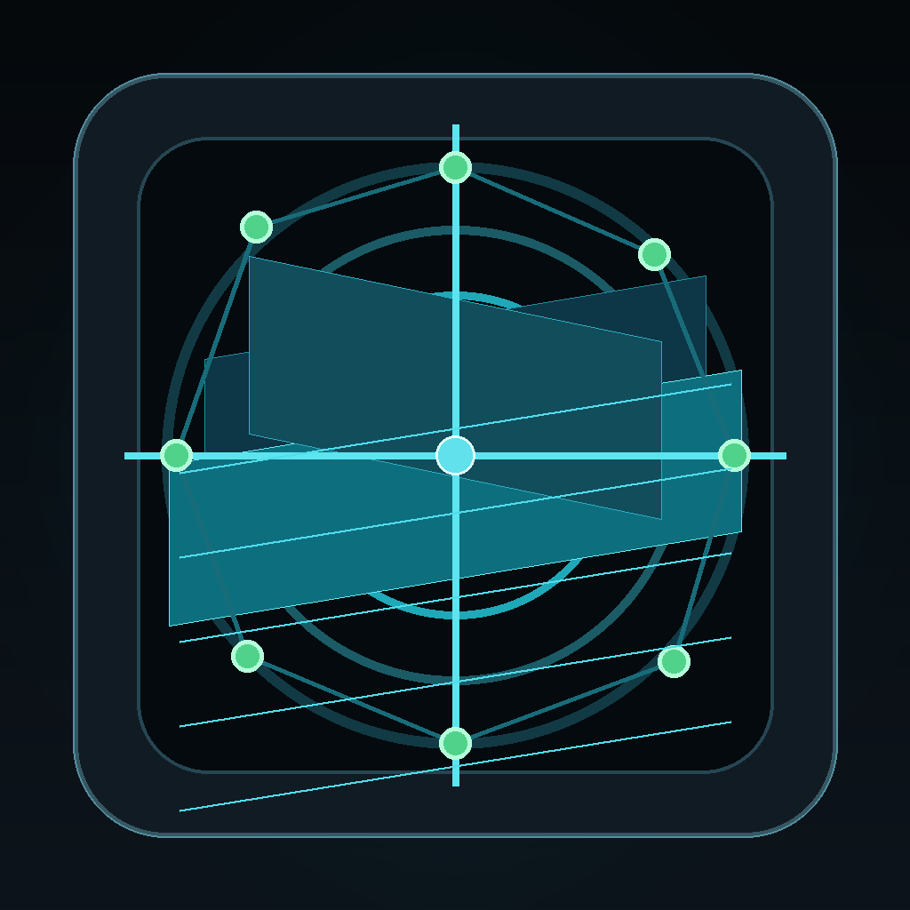

# MOPR

<p align="left">
  
</p>

**Medical Observation & Projection Renderer**

MOPR is a local-first Windows workbench for importing, validating, organizing, and viewing DICOM CT and MRI data. The solution separates presentation, application orchestration, imaging coordination, DICOM processing, persistence, repository operations, and integrity assurance so that each responsibility has one clear owner.

> **Project status:** Active development  
> **Documentation snapshot:** 2026-11-25  
> **Safety notice:** MOPR is currently intended for visualization, research, prototyping, and education. It is not approved for diagnostic use, treatment planning, clinical reporting, or medical decision-making.

## 1. Overview

MOPR provides a guided desktop workflow for physicians and clinical staff who should not need infrastructure knowledge to import and reopen image data. The current application combines a Prism-based WPF shell, feature-specific Prism modules, reusable service assemblies, Entity Framework Core persistence, managed DICOM repositories, and MIRAS integrity assurance.

The principal capabilities are:

- local DICOM import from folders, ready drives, mounted media, mapped drives, and UNC paths
- persistent study, series, instance, user, repository, and measurement data
- reopening imported studies and loading their series into the imaging workspace
- grayscale DICOM display with multi-viewport assignment
- window/level presets and interactive windowing
- slice navigation, zoom, pan, pixel hover, and length measurements
- persistent measurement changes with save, discard, close, study-switch, and exit protection
- protected initial setup and a separate administrative mode
- MIRAS checks, issue classification, user-oriented messages, and controlled recovery actions
- English default resources and German localization

All medical-image processing and all planned machine-learning work are local. Cloud AI is outside the intended architecture. DICOM content, identities, audit information, configuration, and derived data remain under the control of the deployment.

## 2. Current Status

The following areas are implemented in the 2026-11-25 snapshot:

- startup routing, Windows identity resolution, initial user provisioning, and single-instance handling
- initial machine setup and protected setup administration
- DICOM source discovery, classification, import orchestration, persistence, repository placement, rollback, and file-system compensation
- study catalog and imported-series loading
- MIRAS flow integration, repository and persistence checks, issue mapping, release policy, and explicit infrastructure recovery
- imaging study and viewport coordination
- canonical image placement for hover, measurements, zoom, and pan
- slice navigation with frame caching and render throttling
- length measurement hydration and persistence
- centralized imaging-session change tracking and unsaved-change protection

The immediate imaging roadmap starts with rotation, mirror, viewport synchronization, multi-frame DICOM, and angle measurement. These items must not be presented as complete merely because contracts or data models already exist.

## 3. Architecture Principles

### Local First

Medical-image processing, persistence, identity handling, and future machine-learning workflows remain local. This reduces data exposure, avoids cloud availability as a runtime dependency, and keeps deployment-specific security controls authoritative.

### One Responsibility, One Owner

A capability is implemented in one architectural owner. DICOM parsing belongs to `Services.Dicom`; durable relational state belongs to `Services.Persistence`; managed file placement belongs to `Services.Repository`; application workflows belong to `Services.Application`; imaging state coordination belongs to `Services.Core`; and feature presentation belongs to the corresponding Prism module.

### Separation of Concerns

Views and view models do not perform persistence, repository repair, DICOM parsing, Windows identity access, or administrative authorization. They call application or core facades. This keeps UI tests isolated and prevents infrastructure details from leaking into presentation code.

### Ring Dependency Prevention

Dependencies point inward toward stable contracts and services. Lower layers never reference feature modules or the desktop shell. This prevents circular project references, hidden runtime coupling, and service implementations that depend on presentation behavior.

### Reuse Before Duplication

Existing contracts, geometry, coordination services, dialogs, localization infrastructure, and test fixtures are reused before a new implementation is introduced. Parallel implementations of coordinate conversion, session state, import validation, or integrity classification are prohibited because they create inconsistent behavior.

### Shared Services Before New Implementations

Cross-cutting state is centralized in shared services. Examples include the current user, the imaging session, viewport selection, tool selection, window/level, MIRAS flow state, application lifetime, and repository operation coordination. Central ownership gives all consumers the same state and makes lifecycle behavior testable.

## 4. Dependency Direction

The conceptual direction is:

```text
Contracts
    ↓
Core and reusable domain services
    ↓
Application and infrastructure services
    ↓
Prism feature modules
    ↓
Desktop composition root
```

In the concrete solution, `Contracts` is the stable cross-project vocabulary. `Services.Core` and `Services.Dicom` target `.NET Standard 2.1`; Windows and infrastructure-oriented projects target .NET 11. Modules consume facades and shared infrastructure, while `Desktop` composes the complete process.

Allowed dependencies point from a composition or presentation layer to a more stable contract or service layer. `Services.Application` may coordinate DICOM, persistence, repository, and MIRAS services because workflow orchestration is its responsibility. `Desktop` may reference all modules and service factories because it is the composition root.

Forbidden directions include:

- contracts referencing services, modules, or WPF
- service assemblies referencing Prism modules or `Desktop`
- persistence or repository services referencing views or view models
- feature modules bypassing the application facade to write persistence or repository data
- one Prism module directly controlling another module's view model
- a second image-coordinate or transformation implementation beside the canonical imaging geometry system

## 5. Factory and Facade Architecture

Service groups are exposed through factories and facades:

```text
ApplicationFactory  → IApplication
CoreFactory         → ICore
DicomFactory        → IDicom
PersistenceFactory  → IPersistence
RepositoryFactory   → IRepository
MirasFactory        → IMiras
```

Each factory creates and retains the service-group implementation used by the desktop composition root. The facade is the supported entry point for consumers and prevents callers from constructing partial graphs or depending on implementation types.

- `IApplication` exposes desktop workflows such as identity, dialogs, import, studies, imaging-session persistence, administration, recovery, and system checks.
- `ICore` exposes coordinated imaging services and their shared state.
- `IDicom` owns DICOM metadata, image frames, grayscale rendering data, scanning, and low-level import results.
- `IPersistence` owns database initialization, repositories, integrity inspection, imported metadata, and imaging-session persistence.
- `IRepository` owns managed DICOM file placement, verification, repair, validation, and serialized repository operations.
- `IMiras` owns integrity-flow execution, result classification, user messages, recovery coordination, and imaging release decisions.

This model narrows dependencies, gives each assembly a deliberate public surface, and allows tests to replace a facade or one of its contracts without reproducing the production composition root.

## 6. Solution Structure

Generated output such as `bin`, `obj`, `.vs`, `TestResults`, and compiler-generated files is intentionally omitted.

```text
Wpf/
├── global.json
├── MarcusRunge.Mopr.Workbench.slnx
└── MarcusRunge.Mopr.Workbench/
    ├── Contracts/
    ├── Core/
    ├── Desktop/
    ├── Modules/
    │   ├── Identity/
    │   ├── Imaging/
    │   ├── Import/
    │   ├── Miras/
    │   ├── Setup/
    │   └── Studies/
    ├── Services/
    │   ├── Application/
    │   ├── Core/
    │   ├── Dicom/
    │   ├── Miras/
    │   ├── Persistence/
    │   └── Repository/
    └── Tests/
        ├── Desktop.Test/
        ├── Modules.Identity.Test/
        ├── Modules.Imaging.Test/
        ├── Modules.Import.Test/
        ├── Modules.Miras.Test/
        ├── Modules.Setup.Test/
        ├── Modules.Studies.Test/
        ├── Services.Application.Test/
        ├── Services.Core.Test/
        ├── Services.Miras.Test/
        ├── Services.Persistence.Test/
        ├── Services.Repository.Test/
        └── Test.Shared/
```

### Main projects

- **Contracts:** technology-independent application, configuration, identity, imaging, geometry, measurement, and Unreal transfer contracts.
- **Core:** WPF and Prism infrastructure, navigation names, region names, base view models, shared events, and themes.
- **Desktop:** the application composition root, startup and shutdown, machine configuration, Windows integration, administrative authorization, single-instance coordination, and the main window.
- **Modules.Identity:** initial user provisioning and blocked or unavailable identity presentation.
- **Modules.Imaging:** workbench presentation, viewport interaction, geometry, transforms, measurements, overlays, command bar, and properties/series panels.
- **Modules.Import:** guided import-source selection and presentation of progress and structured results.
- **Modules.Miras:** the user-facing “MIRAS action required” workflow.
- **Modules.Setup:** initial setup and protected administration for database, repositories, security, users, and system checks.
- **Modules.Studies:** study catalog, series selection, and reopening imported examinations.
- **Services.Application:** application-level workflows and presentation-safe result mapping.
- **Services.Core:** imaging state and session coordination.
- **Services.Dicom:** DICOM parsing, metadata, frames, grayscale images, and source scanning.
- **Services.Miras:** integrity orchestration, issue mapping, flow state, release policy, and recovery.
- **Services.Persistence:** Entity Framework Core contexts, migrations, entities, repositories, integrity checks, and imaging-session persistence.
- **Services.Repository:** managed DICOM storage, repository scanning, file identity, repair, compensation, and operation coordination.
- **Test.Shared:** reusable test infrastructure, including application lifetime support.

## 7. Contracts Project

`MarcusRunge.Mopr.Workbench.Contracts` targets `.NET Standard 2.1` and defines the stable language shared across different runtime targets. It contains common models rather than WPF, SQL Server, Prism, or repository implementations.

The imaging change contracts are:

- `IImagingSessionChange`: common representation of a persistable change.
- `ImagingSessionChange`: immutable change record combining identity, state, and typed payload.
- `ImagingSessionChangeIdentity`: identifies entity type, `EntityId`, study, optional series, and optional SOP instance.
- `ImagingMeasurementChangeData`: measurement-specific payload used by the generic session-change pipeline.
- `ImagingSessionChangeState`: `Created`, `Modified`, or `Deleted`.

Measurement models include length, angle, annotation, area, ellipse, freehand, point, polygon, rectangle, 3D ROI, segmentation, and volume data. Their presence defines a durable contract vocabulary, not a claim that every corresponding UI tool is implemented.

Geometry contracts such as `Point2D` and `Point3D` are presentation-independent. Shared models also include `StudyInfo`, `SeriesInfo`, `ImagingViewportState`, `ViewportDescriptor`, and DICOM tag information.

## 8. Core Architecture

The core imaging services provide one coordinated state model:

- `IImagingSessionChangeTracker` records typed changes, merges successive changes for the same identity, exposes dirty state, and clears accepted or discarded work.
- `IImagingSessionService` is the central session facade. It owns the active session boundary and exposes pending changes to save/discard workflows.
- `IImagingStudyService` loads and releases the active study and coordinates study-level state.
- `IImagingViewportService` owns viewport descriptors and mutable viewport state.
- `IImagingViewportSelectionService` owns the active viewport independently of the visible view.
- `IImagingToolService` owns the selected imaging interaction tool.
- `IImagingWindowLevelService` owns window/level values and presets.
- `IImagingLayoutService` owns the current viewport layout.
- `IImagingSelectionService` owns series selection used by the imaging workflow.

These services avoid view-model-to-view-model communication and provide deterministic lifecycle points for opening, saving, discarding, switching, and closing an examination.

## 9. Prism Modules

### Identity

**Purpose:** establish a valid local MOPR user after machine setup.  
**Views:** `UserProvisioningView`, `UserBlockedView`, `IdentityUnavailableView`.  
**View models:** matching provisioning, blocked-user, and unavailable-identity view models.  
**Boundary:** consumes application identity services; does not call Windows identity APIs or persistence directly.

### Setup

**Purpose:** initial workstation setup and later protected administration.  
**Views:** setup steps plus administration overview, database, repository, security, user, and system-check views.  
**View models:** `SetupViewModel` and dedicated administration view models.  
**Boundary:** owns presentation and navigation; privileged application services repeat authorization at write boundaries.

### Import

**Purpose:** choose an import source, start import, show progress, cancellation, and result classification.  
**Views:** `ImportView`.  
**View models:** `ImportViewModel`, `ImportSourceViewModel`, `ImportDriveItemViewModel`, and `ImportResultViewModel`.  
**Boundary:** uses `IApplication → IImportService`; it does not parse DICOM, mount media, write repository files, or persist records.

### Studies

**Purpose:** reopen imported examinations.  
**Views:** `StudySelectionView`.  
**View models:** `StudySelectionViewModel`, `StudyItemViewModel`, and `SeriesItemViewModel`.  
**Boundary:** consumes study-catalog and imported-series application services.

### MIRAS

**Purpose:** explain integrity findings and required action without exposing unnecessary technical details.  
**Views:** `MirasActionRequiredView`.  
**View models:** `MirasActionRequiredViewModel` and `MirasIssueItemViewModel`.  
**Boundary:** presents MIRAS results and release decisions; technical checking and recovery remain in services.

### Imaging

**Purpose:** present the imaging workbench and all viewport interaction.  
**Views:** workbench, command bar, image viewer, series panel, properties panel, unsaved-changes dialog, layout host, and viewport tile.  
**View models:** workbench, command bar, series/properties, viewport tile, transforms, measurements, pixel hover, and unsaved-change decisions.  
**Boundary:** UI interaction is translated into core and application services. Durable measurement changes pass through the centralized session-change pipeline.

All WPF views keep code-behind limited to the constructor and `InitializeComponent()` unless a behavior cannot technically provide the required WPF integration.

## 10. Imaging Architecture

### Rendering pipeline

The active study supplies series and instance information. A viewport references the selected series and current slice. `Services.Dicom` loads image-frame data, while the imaging module creates the WPF presentation and overlays. Window/level, slice, and transform state are kept separate so that changing one concern does not recreate unrelated state.

### Window/Level

`IImagingWindowLevelService` centralizes values and presets. Interactive dragging is handled by viewport interaction logic, then propagated through the shared service. Rendering is throttled so rapid pointer input does not force an unbounded sequence of expensive renders.

### Slice navigation

`ViewportSliceNavigation` translates wheel and interaction requests into bounded slice changes. The viewport resolves the corresponding instance/frame, updates hover and measurement context, and schedules rendering. Navigation tests cover direction, bounds, and interaction behavior.

### Zoom and pan

Zoom and pan are stored in `ViewportTransformState`. They affect image placement through the canonical geometry pipeline rather than a second ad-hoc transform. Tests cover transform state and viewport integration.

### Measurement architecture

The active length tool creates image-coordinate endpoints. `IImagingMeasurementContext` associates the measurement with the active study, series, and SOP instance. `IImagingMeasurementInstanceResolver` resolves durable instance identity. `IImagingMeasurementChangeService` converts UI operations into typed session changes. `IImagingMeasurementHydrationService` recreates persisted measurements when a study is loaded.

### Session store

`IImagingMeasurementSessionStore` keeps hydrated and newly created measurements associated with their instance during the active session. It is not the durable database. Persistence is performed only through the session-save workflow.

### Session Change Management

The generic change tracker is the authoritative dirty-state mechanism. Measurement creation, modification, and deletion are registered by stable identity. The command bar and application closing guard inspect this state before destructive lifecycle transitions.

### Frame cache

The viewport maintains a bounded in-memory DICOM frame cache and an order queue. Repeated slice access can reuse decoded frames instead of reopening the same file. The cache is cleared when its owning viewport/study context is released.

### Render throttling

A dispatcher timer with a 40 ms interval coalesces rapid render requests. This protects the WPF dispatcher during windowing and slice interaction while still providing responsive visual feedback.

### Multi-viewport architecture

Layouts and viewport contents are distinct. A layout determines which viewport descriptors are visible; each viewport owns its series assignment, slice, window/level state, transform, hover, and overlays. Viewport selection is centralized, which lets the command bar target one viewport without direct references to controls.

## 11. Canonical Transformation System

There is exactly one image-placement and coordinate-transformation architecture:

```text
ViewportImageGeometryCalculator
                ↓
      ViewportImageGeometry
                ↓
      ViewportImagePlacement
```

`ViewportImageGeometryCalculator` derives the fitted image geometry from image size and viewport size. `ViewportImageGeometry` represents the canonical mapping data. `ViewportImagePlacement` applies the current zoom and pan to determine the final on-screen placement.

The same system is used for:

- pixel hover and image-coordinate lookup
- zoom centered on the current interaction position
- pan displacement
- measurement endpoint display
- conversion between viewport and image coordinates

This is an invariant, not merely a reuse preference. A second coordinate conversion path would cause overlays, hover values, and the rendered image to drift apart after zoom or pan.

## 12. Session Change Management

Session change management centralizes all persistable imaging edits. A change has a stable identity, a state, and typed data.

```text
Imaging UI operation
        ↓
feature change adapter
        ↓
IImagingSessionChangeTracker
        ↓
IImagingSessionService
        ↓
IImagingSessionApplicationService
        ↓
IImagingSessionPersistenceService
        ↓
Entity Framework Core transaction
```

### Change states

- `Created`: the entity exists only in the current session until saved.
- `Modified`: an already durable entity has changed.
- `Deleted`: a durable entity is removed when the session is saved.

Successive operations for the same identity are merged. A created item that is then modified remains `Created`; a created item that is deleted can disappear from the pending set; a durable item modified and then deleted becomes `Deleted`.

`Measurement.EntityId` is the stable identifier that connects the in-memory measurement, session change, and persistence entity. It is independent of viewport object identity and survives save and reload.

### Lifecycle protection

- **Save:** sends the current change set through the application facade and persistence service; only accepted changes are cleared.
- **Discard:** clears pending changes and restores the session from durable state or closes the affected context.
- **Close protection:** closing an active study prompts when changes are pending.
- **Study-switch protection:** opening another study cannot silently replace a dirty session.
- **Application-exit protection:** `WindowClosingGuardBehavior` delegates to `IWindowClosingGuard`; shutdown continues only after save, discard, or explicit cancellation handling.

The architecture is generic so that later findings, reports, annotations, segmentations, and validated 3D artifacts can use the same lifecycle instead of creating parallel save logic.

## 13. DICOM Import

The import path is:

```text
Modules.Import
      ↓
Services.Application
      ↓
Services.Repository ──→ Services.Persistence
      ↓                       ↑
Services.Dicom ───────────────┘
```

Supported operational sources are local directories, ready removable drives, ready optical drives, mapped drives, direct UNC network shares, and mounted virtual drives. Drive discovery is asynchronous and progressive; each inspected drive can appear without waiting for slow or unavailable media.

UNC paths are validated explicitly as network shares. The selected path is checked again when import begins because availability can change between selection and execution.

ISO files are recognized but are not mounted by MOPR. The user must mount the image in Windows and select the resulting virtual drive.

Import classification distinguishes newly imported files, already existing files, other skipped files, invalid input, failures, and cancellation. A repeat import with zero new files is reported as no new image data, not as a new successful import.

Repository and persistence operations form one coordinated workflow. If persistence fails after files were placed, compensation removes or rolls back incomplete repository work. Import does not leave a successful UI result while only half of the durable state exists.

## 14. MIRAS

MIRAS is the **Medical Image Recovery and Assurance System**. Its purpose is to verify that persistence and managed DICOM repository state are safe enough for continued use and to present required action in user-oriented language.

The regular flow is:

```text
startup or explicit check
        ↓
MIRAS flow coordination
        ↓
persistence and repository verification
        ↓
issue mapping and operation classification
        ↓
release policy
        ↓
continue, continue with notice, or require action
```

`MirasFlowState` describes execution: `Idle`, `Running`, `Completed`, `Canceled`, or `Failed`. `MirasOperationStatus` describes the result: `Completed`, `CompletedWithIssues`, `Blocked`, `Incomplete`, or `Failed`. The flow may therefore complete normally while the returned operation status is blocked.

Issues have type, state, alert level, recommended action, user message, and separate technical diagnostics. User messages avoid raw paths, exceptions, and database details where these do not help the user decide what to do.

MIRAS checks do not silently repair repository data. Recovery actions are explicit and use dedicated services. Repository problems do not block all work when a safely usable remainder exists. A finding acknowledged only for the current session is shown again on the next start until its cause is actually resolved.

`MirasImagingReleasePolicy` decides whether imaging may continue from the classified result. Unreal artifacts are outside MIRAS integrity processing and may only be created later from fully validated DICOM and persistence data.

## 15. Studies Module

The Studies module is the user-facing entry point for reopening imported examinations.

### Study catalog

`IStudyCatalogService` reads presentation-safe study and series catalog items through persistence repositories. `StudySelectionViewModel` presents studies and their series without exposing EF entities.

### Study loading

The selection view validates the chosen study and selected series. The application service builds an imported-study load result and passes the data into the core imaging study service.

### Imported series loading

`IImportedSeriesLoadService` resolves persisted series and their instances, including managed repository paths required by the imaging pipeline. The selected series must belong to one study. Loading supports multiple series in the same examination and keeps repository/persistence access out of the module.

## 16. Current Imaging Feature Matrix

| Feature | Status | Notes |
|---|---|---|
| DICOM grayscale display | Implemented | Metadata, frame access, grayscale image data, and viewport presentation |
| Series grouping | Implemented | Based on `SeriesInstanceUID` |
| Multi-viewport assignment | Implemented | Viewports retain separate series and display state |
| Window/Level presets | Implemented | Central service |
| Interactive Window/Level | Implemented | Pointer interaction with render throttling |
| Slice navigation | Implemented | Bounded navigation, frame reuse, and tests |
| Zoom | Implemented | Canonical placement and transform state |
| Pan | Implemented | Canonical placement and transform state |
| Pixel hover | Implemented | Uses shared coordinate conversion |
| Length measurement | Implemented | Image coordinates, pixel spacing, overlays, and hydration |
| Measurement persistence | Implemented | Stable `EntityId`, save/discard, reload, and guards |
| Session change tracking | Implemented | `Created`, `Modified`, `Deleted` merge semantics |
| Close/study-switch/exit protection | Implemented | Unsaved-change decisions protect session transitions |
| Frame cache | Implemented | Bounded viewport cache for decoded frames |
| Render throttling | Implemented | 40 ms dispatcher timer |
| Rotation | Planned next | Rotation data exists in contracts, interaction/rendering is not complete |
| Mirror | Planned next | Not implemented in the current imaging UI |
| Viewport synchronization | Planned | Required before coordinated multi-viewport navigation |
| Multi-frame DICOM | Planned | No complete navigation workflow in this snapshot |
| Angle measurement | Planned | Contract and serializer support do not constitute a finished tool |
| Other measurement types | Contract foundation only | Models exist for later tools; no completion claim |
| Segmentation | Long-term | Requires its own validated workflow and change integration |
| 3D/Unreal artifacts | Long-term | Separate from repository/MIRAS and gated by validated source data |

## 17. Testing

The solution uses isolated unit tests and infrastructure-focused integration tests.

- **Desktop.Test:** single-instance coordination, machine configuration, DPAPI protection, setup completion, Windows authorization and identity, startup routing, and the window-closing guard.
- **Modules.Identity.Test:** provisioning presentation and identity state.
- **Modules.Imaging.Test:** command-bar lifecycle guards, save/close/open decisions, viewport tools and transforms, slice navigation, canonical geometry, measurement change creation, hydration, instance resolution, and session store behavior.
- **Modules.Import.Test:** drive selection, UNC entry, source presentation, and cancellation-sensitive view-model behavior.
- **Modules.Miras.Test:** action-required presentation and issue items.
- **Modules.Setup.Test:** setup mode plus database, repository, security, user, and system-check administration view models.
- **Modules.Studies.Test:** study and series selection behavior.
- **Services.Application.Test:** identity, import resolution and orchestration, repository administration and recovery, study loading, system checks, and user administration.
- **Services.Core.Test:** session-change merge semantics, session service behavior, study loading, and multi-series coordination.
- **Services.Miras.Test:** flow state, concurrency, cancellation, shutdown, issue mapping, localization, release policy, recovery, and edge cases.
- **Services.Persistence.Test:** EF Core integration, identities, measurement `EntityId`, imported metadata, users, and integrity behavior.
- **Services.Repository.Test:** import and repair integration, location validation, coordinator serialization, and compensation.
- **Test.Shared:** common fixtures and application lifetime test support.

Unit tests isolate service and view-model behavior. Integration tests exercise actual EF Core mappings, migrations/models, repository file operations, compensation, and cross-service invariants. Tests requiring local infrastructure may have additional environment prerequisites, but ordinary unit suites must remain runnable without production data.

## 18. Build Requirements

Requirements:

- Windows 10 or Windows 11
- .NET 11 SDK selected by `global.json`
- C# `LangVersion` set to `latest` by the projects
- Visual Studio with the **.NET desktop development** workload
- SQL Server LocalDB for the default desktop persistence configuration

Run commands from the `Wpf` directory:

```powershell
dotnet restore .\MarcusRunge.Mopr.Workbench.slnx
dotnet build .\MarcusRunge.Mopr.Workbench.slnx --configuration Debug
dotnet test .\MarcusRunge.Mopr.Workbench.slnx --configuration Debug
```

Run the desktop application:

```powershell
dotnet run --project .\MarcusRunge.Mopr.Workbench\Desktop\MarcusRunge.Mopr.Workbench.csproj --configuration Debug
```

The solution's PowerShell helper scripts are optional. If a local execution policy blocks unsigned scripts, invoke a script explicitly with `powershell -NoProfile -ExecutionPolicy Bypass -File <path>` rather than changing the system-wide execution policy.

## 19. Roadmap

### Next

1. Rotation using the canonical transformation system
2. Horizontal and vertical mirror using the same transform pipeline
3. Viewport synchronization without coupling viewport controls
4. Multi-frame DICOM navigation and frame identity
5. Angle measurement integrated with session change management and persistence

### Mid-Term

- additional measurement tools based on the existing contracts
- annotations, regions of interest, and measurement editing workflows
- synchronized comparative viewing and richer multi-series layouts
- expanded reporting and findings contracts using the centralized save/discard lifecycle
- performance profiling for large series and cache policies

### Long-Term

- validated segmentation workflows
- local-only machine learning
- volumetric reconstruction and derived 3D models
- Unreal integration for artifacts created only from fully validated DICOM and persistence data
- deployment hardening, backup/restore procedures, and clinical validation work if the product scope later changes

Every new persistable imaging feature must include typed change tracking, save and discard behavior, close/study-switch/exit protection, persistence, hydration, and tests. No feature may introduce a second session lifecycle or a second image-transformation architecture.

## Localization

Each project owns English `Properties/Resources.resx` and German `Properties/Resources.de.resx` resources for its responsibility. C# accesses the generated `Properties.Resources` class; XAML uses the generated static resource properties. Localized enums use `EnumDescriptionTypeConverter` and `LocalizedDescription`.

## Privacy and Operational Safety

MOPR processes medical images and identity data locally. Deployments remain responsible for Windows access control, database and repository permissions, encryption and backup policy, retention, recovery testing, and applicable data-protection requirements. Application identity and auditing complement operating-system security; they do not replace it.

Repository inspection and repair are separate operations. MIRAS reports integrity findings and required actions, while repair remains explicit. The application may continue in a safe reduced mode when a finding does not affect the data required for the current task.

## License

See [LICENSE](LICENSE).
